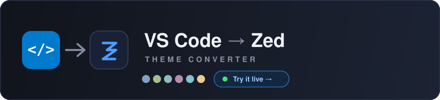

# VS Code → Zed Theme Converter (Web)

[](https://paracells.github.io/zed-theme-converter/)

A free, browser-based converter that turns VS Code themes — a `.vsix` extension
or a theme `.json` — into [Zed](https://zed.dev) theme files (schema `v0.2.0`).

**Everything runs client-side in your browser.** Your theme file is never uploaded
to any server — the conversion happens locally via JavaScript. That's what makes
it deployable to any static host for free.

## What it does

- Accepts a **`.vsix`** (extracts every theme inside, reads the manifest) or a
  single theme **`.json`**.
- Robust **JSONC** parsing — tolerates `//` / `/* */` comments and trailing commas.
- Resolves VS Code theme **`include`** inheritance chains.
- Auto-detects **dark/light** appearance, display name, and publisher/author.
- Maps TextMate scopes → Zed syntax keys, filters transparent fills, guarantees a
  readable active tab and visible borders.
- Live **preview** of each converted theme, then **download** the `.json`.

## Project layout

```
theme-converter-web/
├── index.html        # UI markup
├── css/style.css     # styling
└── js/
    ├── converter.js  # conversion engine (pure logic, no DOM)
    └── app.js        # UI glue: file intake, VSIX extraction, download
```

## Notes

- VSIX extraction uses [JSZip](https://stuk.github.io/jszip/) from a CDN; the app
  needs an internet connection the first time to fetch it.
- A single `.json` uploaded on its own can't resolve `include`s that point to
  sibling files you didn't provide — upload the `.vsix` if the theme inherits.
- Output is a faithful conversion, not pixel-perfect. Use the **Style overrides**
  box (`key=#color` per line) to nudge anything that looks off.

## License

MIT.
